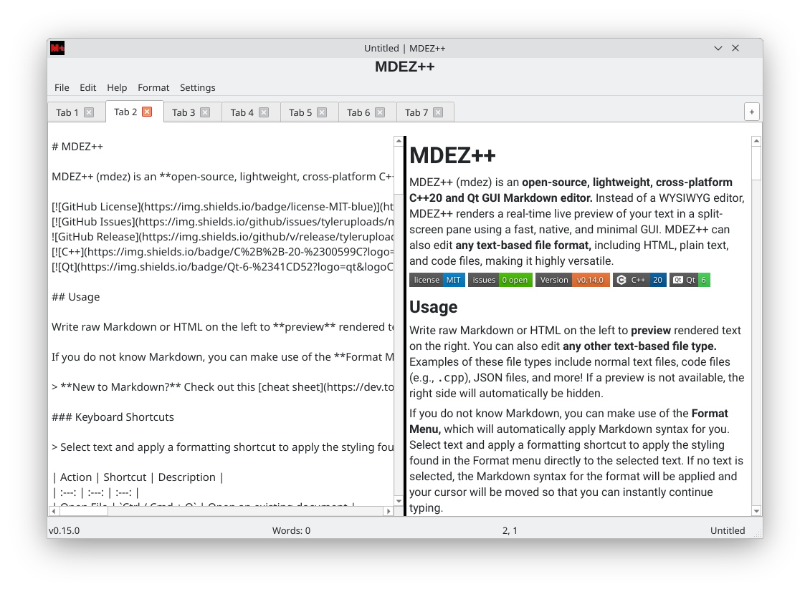

# MDEZ++

MDEZ++ (mdez) is an **open-source, lightweight, cross-platform C++20 and Qt GUI Markdown editor.** Instead of a WYSIWYG editor, MDEZ++ renders a real-time live preview of your text in a split-screen pane using a fast, native, and minimal GUI. MDEZ++ can also edit **any text-based file format,** including HTML, plain text, and code files, making it highly versatile.

[](https://github.com/tyleruploads/mdez/blob/main/LICENSE)
[](https://github.com/tyleruploads/mdez/issues)

[](https://isocpp.org/)
[](https://www.qt.io/)
<a href='https://flathub.org/apps/io.github.tyleruploads.mdez'>
    
</a>



## Usage

Write raw Markdown or HTML on the left to **preview** rendered text on the right. You can also edit **any other text-based file type.** Examples of these file types include normal text files, code files (e.g., `.cpp`), JSON files, and more! If a preview is not available, the right side will automatically be hidden.

If you do not know Markdown, you can make use of the **Format Menu,** which will automatically apply Markdown syntax for you. Select text and apply a formatting shortcut to apply the styling found in the Format menu directly to the selected text. If no text is selected, the Markdown syntax for the format will be applied and your cursor will be moved so that you can instantly continue typing.

> **New to Markdown?** Check out this [cheat sheet](https://dev.to/thetylern/a-markdown-cheat-sheet-for-anywhere-32bp)!

### Keyboard Shortcuts

> Select text and apply a formatting shortcut to apply the styling found in the Format menu directly to the selected text. If no text is selected, the Markdown syntax for the format will be applied and your cursor will be moved so that you can instantly continue typing.

| Action | Shortcut | Description |
| :---: | :---: | :---: |
| Open File | `Ctrl / Cmd + O` | Open an existing document |
| Save As | `Ctrl / Cmd + Shift + S` | Save the current document under a new name or location |
| Save | `Ctrl / Cmd + S` | Save changes to the current document |
| Print | `Ctrl + P` | Print the current document |
| Bold | `Ctrl+B` | Insert bold text |
| Italic | `Ctrl+I` | Insert italicized text |
| Heading 1 | `Ctrl+Alt+1` | Insert a level one heading |
| Heading 2 | `Ctrl+Alt+2` | Insert a level two heading |
| Heading 3 | `Ctrl+Alt+3` | Insert a level three heading |
| Horizontal Divider | `Ctrl+D` | Insert horizontal divider |
| Block Quote | `Ctrl+]` | Insert a block quote |
| Strikethrough | `Alt+Shift+5` | Insert strikethrough text |
| Link | `Ctrl+K` | Insert a link |
| Image | `Ctrl+Shift+I` | Insert an image |
| Code | `Ctrl+\` | Insert a code block |
| Inline Code | `Ctrl+E` | Insert inline code |
| Undo | `Ctrl+Z` | Undo latest change done to text |
| Redo | `Ctrl+Shift+Z` | Redo latest change to text |
| Copy | `Ctrl+C` | Copy selected text to clipboard |
| Paste | `Ctrl+V` | Paste text from clipboard |
| Cut | `Ctrl+X` | Move selected text to clipboard |
| Select All | `Ctrl+A` | Select all text from editor |

### Menu Tree

#### File

* `Open File` (`Ctrl+Shift+O`) — Open an existing document
* `Save As` (`Ctrl+Shift+S`) — **(NOT SUPPORTED ON WEB)** Save the current document under a new name or location
* `Save` (`Ctrl+S`) — Save changes to the current document
* `Print` (`Ctrl+P`) — **(NOT RELIABLE ON WEB)** Print the current document
* `Export as HTML` (`No combination`) — Export the current document under the HTML format

#### Edit

* `Undo` (`Ctrl+Z`) — Undo latest change to text
* `Redo` (`Ctrl+Shift+Z`) — Redo latest change to text
* `Copy` (`Ctrl+C`) — Copy selected text to clipboard
* `Paste` (`Ctrl+V`) — Paste text from clipboard
* `Cut` (`Ctrl+X`) — Move selected text to clipboard
* `Select All` (`Ctrl+A`) — Select all text from editor

#### Help

* `About MDEZ++` — Displays legal information about MDEZ++ and the Qt Framework
* `MDEZ++ License` — Displays the full MDEZ++ License
* `About Qt` — Displays more in-depth legal information about the Qt Framework
* `Fun Facts!` — Shows fun facts
* `Markdown Cheat Sheet` — Opens a link to [A Markdown Cheat Sheet for Anywhere by tyleruploads on DEV](https://dev.to/thetylern/a-markdown-cheat-sheet-for-anywhere-32bp) 
* `Keyboard Combinations` — Displays keyboard combinations for MDEZ++
* `Report Issue` — Opens a link to [report an issue in MDEZ++ via GitHub](https://github.com/tyleruploads/mdez/issues/new)
* `Check for Updates` — Opens a link to [the latest GitHub release of MDEZ++](https://github.com/tyleruploads/mdez/releases/latest)

#### Format

* `Bold` (`Ctrl+B`) — Insert bold text
* `Italic` (`Ctrl+I`) — Insert italicized text
* `Heading 1` (`Ctrl+Alt+1`) — Insert a level 1 heading
* `Heading 2` (`Ctrl+Alt+2`) — Insert a level 2 heading
* `Heading 3` (`Ctrl+Alt+3`) — Insert a level 3 heading
* `Horizontal Divider` (`Ctrl+D`) — Insert a horizontal divider
* `Block Quote` (`Ctrl+]`) — Insert a block quote
* `Strikethrough` (`Alt+Shift+5`) — Insert strikethrough text
* `Link` (`Ctrl+K`) — Insert a link
* `Image` (`Ctrl+Shift+I`) — Insert an image
* `Code` (`Ctrl+\`) — Insert a code block
* `Inline Code` (`Ctrl+E`) — Insert inline code

#### Settings

> These settings persist automatically via local configuration files or browser local storage

* `Autosave (Seconds)` — **(NOT SUPPORTED ON WEB)** Enable or disable autosave and set the autosave interval
* `Font Size for Editor` — Set the font point size for the editor
* `Relative Font Size for Render (based on Body Text)` — Set the font point size of the render relative to the body text point size
* `End of Line Character` — Choose between Windows style `\r\n` and UNIX/macOS style `\n` line endings
* `Enable Line Wrapping in Editor` — Enable or disable line wrapping in the editor
* `Show fun facts after application initialization` — Enable or disable the showing of fun facts automatically after application initialization

## Downloads & Installation

Installation of MDEZ++ is very simple! All you need to do is download and open the appropriate **portable, pre-compiled binary** for your operating system. MDEZ++ is also on **Flathub**, the de-facto Linux App Store. Alternatively, can use the **MDEZ++ Setup Script for Linux,** which allows you either compile locally, or install the AppImage from the latest GitHub Release.

> Certain features are not available in the Web download due to browser restrictions and other factors, such as choosing file save paths.

### Install from Flathub

MDEZ++ can be installed directly from [Flathub](https://flathub.org/en/apps/io.github.tyleruploads.mdez)!

To install MDEZ++, simply run the following command in any terminal! The Flatpak CLI, setup with Flathub, is a prerequisite.

```bash
flatpak install flathub io.github.tyleruploads.mdez
```

### Linux Setup Script

To run the Linux Setup Script, run the following command in your terminal:

```bash
bash <(curl -s https://raw.githubusercontent.com/tyleruploads/mdez/refs/heads/main/setup.sh)
```

You can also download the file at [https://raw.githubusercontent.com/tyleruploads/mdez/refs/heads/main/setup.sh](https://raw.githubusercontent.com/tyleruploads/mdez/refs/heads/main/setup.sh), mark it as executable, then run it.

In the script, you have 4 options:

1) **Install Remote AppImage:** Installs the AppImage attached to the latest GitHub Release
2) **Compile Locally and Install:** Locally compiles and installs the latest state of the live repository
3) **Uninstall MDEZ++:** Uninstalls MDEZ++
4) **Exit:** Exits the script

---

### Downloads Table

| Linux | Windows | macOS | Web Download | Web Page |
| :---: | :---:   | :---: | :---: | :---: |
| [MDEZ++ AppImage](https://github.com/tyleruploads/mdez/releases/latest/download/MDEZ++-x86_64.AppImage)<br />[Flathub Webpage](https://flathub.org/en/apps/io.github.tyleruploads.mdez)| [MDEZ++ Windows Executable](https://github.com/tyleruploads/mdez/releases/latest/download/mdez-windows.zip)| Not Supported | [MDEZ++ Web (WASM) Download](https://github.com/tyleruploads/mdez/releases/latest/download/mdez-wasm.zip) | [MDEZ++ Web (WASM) on GitHub Pages](https://tyleruploads.github.io/mdez/)

#### Note for Linux Users

You must mark the **standalone AppImage** as executable before it can be run!

```bash
chmod +x MDEZ++-x86_64.AppImage
```

#### Note for Windows Users

If you do not know what to do with the zip file, follow these steps.

1. Download [mdez-windows.zip](https://github.com/tyleruploads/mdez/releases/latest/download/mdez-windows.zip) and extract it
2. Open the extracted folder, navigate to build -> Release, and then run the file named `mdez-windows.exe` (the file extension may not be automatically shown for you)
3. If a SmartScreen window is displayed:
    + Click More Info under the text
    + Click the Run Anyway button at the bottom
    + Note: This is normal behavior for open-source software not signed with a commercial Microsoft developer key

## Features

- **Smart View:** Automatically switches between live-previews of Markdown or HTML or a single-pane plaintext editor based on file MIME type.
- **WebAssembly (WASM) Support:** Supports WebAssembly, allowing MDEZ++ to be run in the browser.
- **Multi-Format Output Support:** No matter what you are editing, you can always print it!
- **Metadata in Status Bar:** View important information such as the version, word count, position in text, and file path in the status bar!
- **Fun Facts:** View interesting fun facts at the start of the program and by finding them in the Help menu.

## Contributing

Contributions are what make open-source projects important. All contributions are highly appreciated

* **Found a bug or issue**: Open an Issue and show the output of the script, the steps to reproduce it, and as much information as possible
* **Have an idea**: Open an Issue and explain your idea as much as possible, why you think it would be a good addition to the project, and any other important information.

## Security

For information on reporting security vulnerabilities in MDEZ++, see [SECURITY.md](SECURITY.md)

## License

This project is licensed under the MIT License - see the [LICENSE](LICENSE) file for more information.
